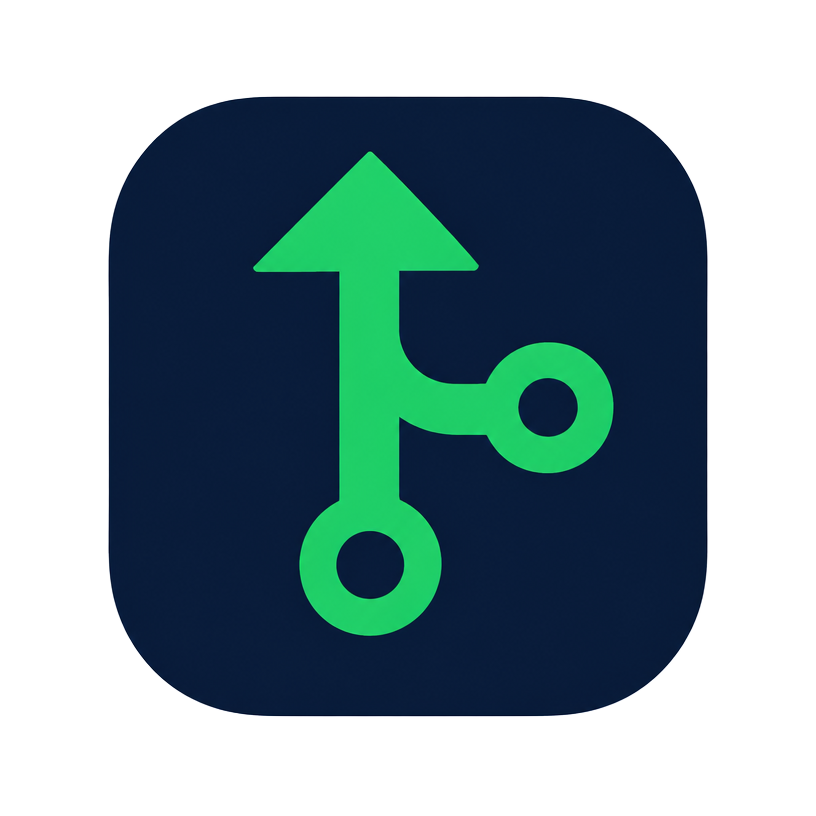

# CodePush — Solved Problems to GitHub

<p align="center">
  
  <br>
  <b>Push your solved competitive programming problems to GitHub in one click.</b>
  <br>
  <i>Chrome Extension • Manifest V3 • Version 1.1.0</i>
</p>

---

## ⚡ Overview

**CodePush** automatically detects your solved problems on **GeeksforGeeks**, **HackerRank**, and **CodeChef**, extracting the problem title, difficulty rating, programming language, and accepted solution code. It injects a floating **"Push to GitHub"** button directly onto the problem page and gives you a native side panel to manage your solutions.

- **100% Private**: Your GitHub Personal Access Token is saved strictly in `chrome.storage.local` on your machine and communicates directly with `api.github.com`. No external servers.
- **Preserves Git History**: Updating or re-pushing an existing problem commits directly to the existing file path, preserving your commit streaks and iterative time-complexity optimizations.
- **Automated Hierarchy**: Automatically structures commits into `<repoName>/<Platform>/<problem-slug>.<ext>`. Auto-initializes the `coding-solutions` repository if it doesn't already exist.

---

## 🚀 Supported Platforms

| Platform | Capabilities | Target Path |
|---|---|---|
| **GeeksforGeeks** | Practice problems & Problem of the Day (POTD) | `coding-solutions/GeeksforGeeks/<slug>.<ext>` |
| **HackerRank** | Algorithm & Data Structure tracks | `coding-solutions/HackerRank/<slug>.<ext>` |
| **CodeChef** | Practice tasks, Contests & Division problems | `coding-solutions/CodeChef/<slug>.<ext>` |

---

## 📦 Installation (60 Seconds)

1. Download **`codepush-extension.zip`** from this repository.
2. Unzip it into a permanent folder on your computer (do not delete this folder after loading).
3. Open `chrome://extensions` in Google Chrome (or Edge/Brave).
4. Enable **Developer mode** via the top-right toggle switch.
5. Click **Load unpacked** and select the unzipped folder (the one containing `manifest.json`).
6. Click the Chrome puzzle-piece icon and **pin CodePush** to your toolbar.

> **Troubleshooting:** If you see *"Manifest file is missing or unreadable"*, make sure you select the inner folder that directly contains `manifest.json`, not the parent wrapper folder.

---

## 🔑 GitHub Setup

1. Generate a Personal Access Token on GitHub with `repo` scope:
   [https://github.com/settings/tokens/new?scopes=repo&description=CodePush](https://github.com/settings/tokens/new?scopes=repo&description=CodePush)
2. Copy the generated token (starts with `ghp_` or `github_pat_`).
3. Click the **CodePush** icon in your browser toolbar to open the side panel.
4. Paste your token and click **Connect GitHub**. You'll see `Connected as @<username> ✅`.

---

## 📁 Repository Structure Example

```text
coding-solutions/
├── GeeksforGeeks/
│   └── two-sum.py
├── HackerRank/
│   └── solve-me-first.cpp
└── CodeChef/
    └── test-problem.java
```

---

## 🛠️ Permissions Audit

- `storage`: Secure local storage for your GitHub token and settings.
- `activeTab`: Detects problem details only when you open a supported problem tab.
- `sidePanel`: Side panel UI to manage and edit solutions.
- `api.github.com`: Direct API calls to create commits and manage repository files.
- Platform hosts: `geeksforgeeks.org`, `hackerrank.com`, `codechef.com`.

---

## 👤 Author

Developed with care by **[Rajendra Kandiboyina](https://github.com/rajendra-18git)**.
